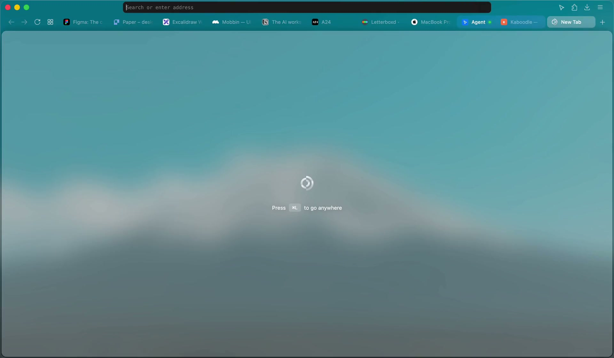

### `Koi Browser`

[](https://github.com/Awhalen1999/koi/releases/latest)
[](https://github.com/Awhalen1999/koi/releases)


[](https://koi.surf)
[](LICENSE)

Koi takes the best parts of every browser and fixes the bad parts. The window is frosted glass, calm and right at home on macOS. It's built on Firefox, so your passwords, bookmarks and extensions carry over when you sign in. No telemetry, nothing to learn. Free for macOS.



## Install

Download the latest release from [koi.surf](https://koi.surf) or [here](https://github.com/Awhalen1999/koi/releases/latest), open the DMG, and move Koi into your `Applications` folder. Koi updates itself.

## Building

Requires Xcode command line tools, Node 26, Python 3, and GNU tar (`brew install gnu-tar`).

```sh
npm install
npm run download             # fetches Firefox into engine/
npx surfer set brand release # once per clone
npm run bootstrap            # Mozilla's build toolchain
npm run import               # applies patches and branding, generates prefs
npm run build
npm start
```

## License

Koi is available under the [Mozilla Public License 2.0](LICENSE). It's built on Firefox, Mozilla's work, with [surfer](https://github.com/zen-browser/surfer).
