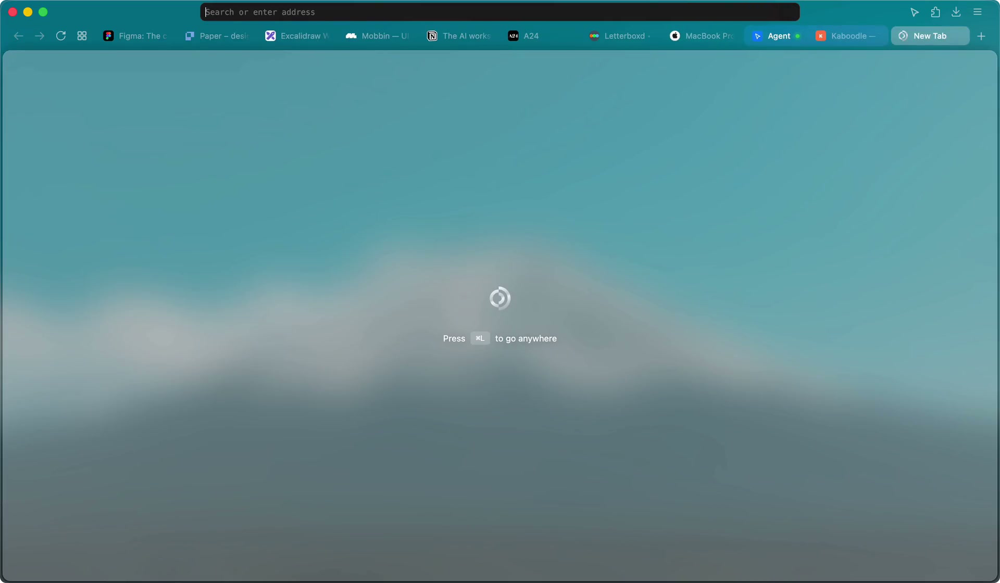

### `Koi Browser`

## Install

Download the latest release from [koi.surf](https://koi.surf) or [here](https://github.com/Awhalen1999/koi/releases/latest), open the DMG, and move Koi into your `Applications` folder. Koi updates itself.

## Firefox version

[`Release`](https://github.com/Awhalen1999/koi/releases/latest) Is currently built using Firefox version `157.0`

## License

Koi is available under the [Mozilla Public License 2.0](LICENSE). It's built on Firefox, Mozilla's work, with [surfer](https://github.com/zen-browser/surfer).
